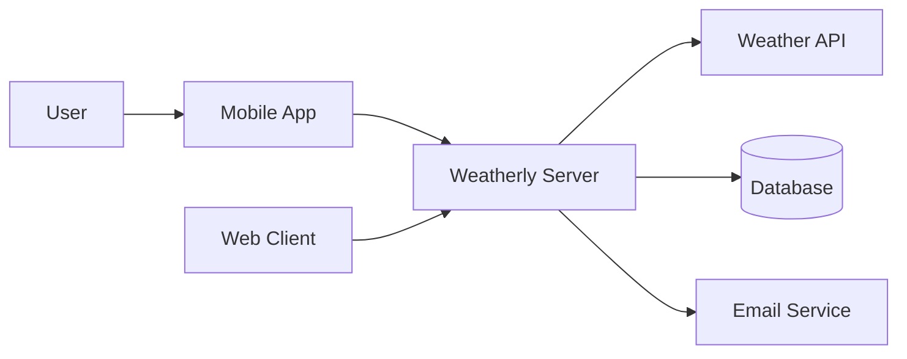

# Project Proposal

**AI-Assisted Software Development · Atlas University · Fall 2026–2027**

| | |
|---|---|
| **Student** | *230504603 · Khadija · Sabir* |
| **Section** | *en* |
| **Project** | *Weatherly — Weather Forecasting and Avatar Styling App* |

WHAT A PROPOSAL IS FOR
A proposal convinces a busy reader — an instructor, an investor, a manager — in five
minutes that you know what you are building, for whom, and why it can be finished. It is
also a promise to yourself: every week from now on the checker reads it, and in December
you defend the product against it. Write it so that a classmate who has never heard of
your idea could explain it to someone else after one reading.

HOW TO WRITE IT
- Order: write §3 Problem first, then §4 Solution, then §5–§7. Write §2 Summary and
  §1 Title LAST — you can only summarise what you have already written.
- Plain and specific. Short sentences. Names, numbers, times, places. No marketing words:
  "innovative", "seamless", "revolutionary", "user-friendly" say nothing.
- One product. If you catch yourself writing "and also…", you have two projects; keep one.
- Small enough to finish. You have ten weeks, alone, for a mobile app, a web client and a
  server on a public store. A product with three features that ship beats one with ten that
  do not. You can always add in Week 10; you can never subtract in Week 11.
- AI may help you draft. Then read every sentence and ask: is this true about MY product?
  Assistants love to add features you never asked for; delete them.

HOW TO READ THE COMMENTS BELOW
Each section has WHY (what the section is for), WHAT (what to write), CHECK YOURSELF
(questions to ask before you move on), and a WEAK and a STRONG example. All examples
describe one invented project, "StudyRoom" (booking a study room in the university
library), so you can see how the sections connect. It is not your project and not text to
copy — write about yours. Comments are invisible on GitHub and the checker does not count
them, so you may leave them in place.

RULES
- Keep every heading exactly as written; the checker finds sections by heading.
- Each heading carries an IDEAL length in parentheses ("about 600 characters"). It is a
  guide, not a limit: it tells you how much a good answer usually needs. Longer is allowed
  and is never marked down by the checker — but say more only if it adds something; a
  reader values the short, specific version. The count is the text under the heading,
  spaces included, not the heading and not the comments. For scale: this paragraph is about
  450 characters.
- DIAGRAMS: every diagram in this course is written in Mermaid, inside a mermaid fenced
  block, in the markdown file itself. No images, no links to external tools. GitHub renders
  Mermaid on the page and the checker parses it; a diagram that does not parse is shown as
  raw text on GitHub and fails the check. The block must appear directly under the heading
  that asks for it.

---

## Part A — What you will build (Week 2)

### 1. Weatherly — weather forecasts, avatar styling (about 80 characters)

WHY: The title matters because “Weatherly” is simple, easy to remember, and directly connects to the main purpose of the app: helping users understand and prepare for the weather. The name also fits the app’s interactive side, where users can see weather-based clothing recommendations on a customizable avatar.

WHAT: Weather forecasts and personalized weather-based avatar styling

CHECK YOURSELF: Yes. A stranger can understand that Weatherly is related to weather from the title and description. “Weatherly” is short, easy to say, easy to remember, and easy to search for.

WEAK: "Weather App” · “Weather Forecast App” · “Weatherly App”

STRONG: “Weatherly — check tomorrow’s weather and dress your avatar for it”

### 2. One-paragraph summary (about 400 characters)

WHY: Weatherly is a weather and lifestyle app for people who want more than a basic weather forecast. It makes weather information more useful and interactive by giving recommendations based on the weather, such as suitable places to visit, activities to do, and what to wear. Users can also create and customize an avatar to make the experience more personal.

WHAT: Weatherly is a mobile app and web client for people who want to check tomorrow’s weather and plan their day around it. It provides weather forecasts, alerts, recommendations for places and activities, and weather-based outfit suggestions. Users can customize an avatar with different clothes, hairstyles, makeup, and body sizes to see how suitable outfits look on them.

CHECK YOURSELF: Yes. The paragraph clearly explains what Weatherly is, who it is designed for, what users can do, and what makes it different from a regular weather app. It focuses on the main features without explaining the technology or development process. It can also be read aloud quickly without unnecessary details.

WEAK: Weatherly is an innovative weather application that provides useful weather information and recommendations. It helps users plan their day using modern technology and provides an enjoyable experience for everyone.

STRONG: Weatherly is a mobile app and web client that helps users prepare for tomorrow’s weather. It provides forecasts, alerts, outfit suggestions, and recommendations for places and activities based on the expected weather. Users can also customize an avatar with different clothes, hairstyles, makeup, and body sizes to see suitable outfits on themselves. 

### 3. Problem (about 600 characters)

WHY: People often need to make several decisions based on tomorrow’s weather, such as what to wear, whether to carry an umbrella, where to go, and what activities to plan. However, this information is usually checked separately, making it harder to quickly understand how the weather should affect their plans.

WHAT: Students and young adults planning an outdoor day face this problem when preparing for tomorrow’s activities. For example, before leaving home, they check a weather website for tomorrow’s temperature and rain, then use separate searches to check weather alerts, suitable places, activities, and outfit ideas. They currently rely on different websites and search engines to collect this information. This process takes extra time because they have to check several sources and make decisions separately. It can also lead to unsuitable clothing, cancelled plans, or unnecessary trips when the weather is different from what they expected.

CHECK YOURSELF: Yes, a classmate could picture the situation because it describes a student preparing for tomorrow, checking the weather, searching for alerts and activities, and choosing what to wear. There is no measured number yet because we have not counted how long this process takes or asked a specific number of users. People who regularly plan their day around the weather would likely recognize the problem of checking several sources and spending extra time to make these decisions.

WEAK: People have difficulties checking the weather and planning their day. Weather information can be confusing, and people may waste time deciding what to wear or where to go.

STRONG: A student planning an outdoor day for tomorrow checks a weather website for the temperature and chance of rain, then searches separately for weather alerts, suitable activities, and places to visit. They may also search for outfit ideas because the forecast does not show what clothing would be suitable. When all this information is spread across different sources, the student spends extra time checking and comparing information and may still choose unsuitable clothes, an unsuitable activity, or a place that is not appropriate for the weather. 

### 4. Solution (about 600 characters)

WHY: Weatherly is designed to make planning for tomorrow’s weather simpler by bringing the important information and decisions together in one place. It helps users understand the expected weather, decide what to wear, choose suitable places and activities, and prepare for possible weather alerts. The goal is to reduce the extra time users spend checking different sources while making their daily planning more interactive and personal.

WHAT: Users can check tomorrow’s temperature and rain forecast, receive weather alerts, get recommendations for suitable clothes, places, and activities, and customize an avatar to see how different outfits look on them. The forecast and alerts reduce the need to search multiple sources for weather information. The recommendations reduce the time spent separately searching for suitable activities and places, while the avatar helps users choose suitable clothing. Weatherly does NOT provide navigation, bookings, or emergency services.

CHECK YOURSELF:  Yes. Each feature answers a problem from §3: the forecast and alerts reduce the need to check different weather sources, the recommendations reduce the need to separately search for places and activities, and the avatar helps users decide what to wear. The problem of spending extra time collecting information is also addressed by bringing these features together. The planned features are realistic to build alone within ten weeks because the project has a limited scope and does not include navigation, bookings, or emergency services.

WEAK:  A smart, user-friendly weather app that uses AI to provide accurate forecasts, personalized recommendations, avatar customization, alerts, and many other useful features
         
STRONG: A user checks tomorrow’s temperature and rain forecast, receives weather alerts, gets recommendations for suitable clothes, places, and activities, and customizes an avatar to see different outfits. These features help the user plan the next day without checking several sources. Weatherly does NOT provide navigation, bookings, or emergency services.

### 5. How it works (about 600 characters + one diagram)

WHY: Weatherly needs to connect weather information with recommendations and avatar customization so that users can plan for tomorrow in one place. 

WHAT: Users use the mobile app to check tomorrow’s weather, receive alerts, get recommendations for clothes, places, and activities, and customize their avatar and outfits. The same users can use the web client on a laptop or computer to access these features. The server receives weather data, stores user and avatar information, and decides which recommendations and alerts to show based on weather conditions. Weatherly stores user, avatar, and application data in a Firebase Firestore database hosted on Google Cloud. Users log in with an e-mail code or OTP sent to their e-mail address by the system’s e-mail service. AI is not required for the main product because Weatherly uses predefined rules to provide weather-based recommendations.

CHECK YOURSELF: Each feature in §4 has a clear part that handles it. The mobile and web clients show the forecast, alerts, recommendations, and avatar features to the user. The server receives weather data, applies the rules for recommendations and alerts, and stores user and avatar data in the database. Neither client stores important data that should only be kept on the server. The login code is sent by the e-mail service, and no AI is used inside the product.

WEAK: Weatherly has a mobile app, web client, server, and database that work together to show weather information. The system uses AI and modern technology to provide smart recommendations and personalized features.

STRONG: Users use the mobile app or web client to check tomorrow’s forecast, alerts, recommendations, and avatar outfits. The server gets the weather data, applies rules to select suitable clothes, places, and activities, and stores users and avatar data in Firebase Firestore hosted on Google Cloud. The server also handles login codes through the e-mail service. Both clients get their data from the server and do not store important application data themselves. No AI is used inside the product. 

### 6. Technologies (about 300 characters)

WHY: Choosing technologies that we understand and can test early will reduce technical problems later. The stack should support the mobile app, web client, server, database, weather API, and login system while remaining realistic to build and maintain within ten weeks.

WHAT: Weatherly will use Flutter for the mobile app, React for the web client, Node.js with Express for the server, Firebase Firestore for the database, Firebase Hosting for the web client, and Google Cloud Run for the server. Firebase Authentication will handle e-mail login codes, and the mobile app will be distributed through the Samsung Galaxy Store. 

CHECK YOURSELF: Not all technologies have been installed or tested with a Hello World yet, so they need to be tested before development starts. Firebase and Google Cloud have free tiers, but their usage limits and prices should be checked before deployment. Flutter apps can be published on the Google Play Store, so the planned mobile stack is supported.

WEAK:   Flutter, React, Node.js, Firebase, Google Cloud, AI, and other modern technologies.”

STRONG: Mobile: Flutter (Android first). Web: React. Server: Node.js with Express. Database: Firebase Firestore. Hosting: Firebase Hosting for the web and Google Cloud Run for the server. Login e-mail: Firebase Authentication. Store: Google Play. AI: none in the product. 

### 7. Success criteria (about 400 characters)

WHY: Success criteria define how we will know that Weatherly works as planned at the end of the project. They give us clear results to test, such as whether users can check tomorrow’s weather, receive alerts, get suitable recommendations, customize their avatar, and use the mobile and web clients without major problems.

WHAT: A user can open the mobile app and see tomorrow’s forecast, alerts, and recommendations within 5 seconds. A user can customize an avatar and create a weather-appropriate outfit in under 2 minutes. A user can open the web client and view tomorrow’s weather information within 5 seconds. At least 5 other people can use Weatherly and complete the main features without assistance. At least 4 out of 5 users can successfully complete the main features during testing.

CHECK YOURSELF: Yes. A classmate can test each criterion by using a stopwatch, counting successful users, or checking whether an action works. Each criterion has a clear result, so there is no need to ask for extra explanation. Weatherly could fail these tests if the forecast takes too long to load, the avatar cannot be customized, the web client does not work, or users cannot complete the main features without help.

WEAK: Weatherly will be fast, accurate, user-friendly, and enjoyable. Users will be satisfied with the weather information and recommendations. 

STRONG: A new user opens Weatherly and sees tomorrow’s forecast, alerts, and recommendations within five seconds. A user customizes an avatar and creates a suitable outfit for tomorrow’s weather in under two minutes. During the beta week, at least five classmates each use Weatherly and complete the main features at least once without help. A user opens the web client and sees the latest weather information within five seconds. 

## Part B — Why it is worth building (Week 3)

<!--
Part B is next week's work, together with the design. Read it now so you know where you
are going; write it in Week 3. The same StudyRoom examples continue.
-->

### 8. Market and target users (about 500 characters)

WHY: Weatherly needs a clear group of people who would actually use it. The main target users are students and young adults who check the weather when planning their clothes, activities, and places to visit. Knowing who these users are and roughly how large this group is helps us decide which features to build and how to design the product around their needs.

WHAT: Weatherly is mainly for university students and young adults who check the weather before choosing what to wear, where to go, or what to do. For the first test, we can reach at least 20 students through our university and personal networks. We will ask 20 classmates whether they check the weather regularly and whether they would use weather-based recommendations and avatar outfits. The wider market size will be supported by a named public source after the survey is completed. 

WEAK: Many students and young people would find Weatherly useful because everyone checks the weather and wants to plan their day easily. 

STRONG: Our first users will be university students who regularly check the weather before planning their day. We can reach at least 20 students through university class groups and personal networks. We will ask 20 classmates whether they check tomorrow’s weather, search separately for outfit or activity ideas, and would use Weatherly’s recommendations and avatar features. Their answers will provide our first user evidence, while a named public source will be used to estimate the wider market. 

### 9. Competitors (about 500 characters)

WHY: Users already solve this problem by checking weather apps, searching for outfit ideas, and looking up places and activities separately. Some use different websites or social media to collect this information. Knowing how users solve the problem today helps us see what these alternatives offer and what they do not provide together. This tells us that Weatherly should make planning easier by combining weather, alerts, recommendations, and avatar-based outfit planning in one place.

WHAT: AccuWeather provides weather forecasts and alerts and has a free version, but users still need other sources for outfit ideas, activities, and places to visit. Google Search is free and lets users search for weather, clothing, activities, and places, but the information is spread across different results and takes extra time to collect. Pinterest is free and provides outfit and activity ideas, but it does not provide weather forecasts or connect its suggestions directly to tomorrow’s weather.

WEAK: Weatherly has no real competitors because it combines weather forecasts, recommendations, and avatar customization in one product. 

STRONG:AccuWeather is a free weather service that provides forecasts and alerts, but it does not provide outfit, activity, or place recommendations based on the weather. Google Search is free and can be used to find weather information, outfit ideas, activities, and places, but users have to search for each type of information separately. Pinterest is free and provides outfit and activity inspiration, but it does not provide weather forecasts or connect its suggestions directly to tomorrow’s weather.

### 10. Comparison and your advantage (about 500 characters)

WHY: Users already have weather apps and websites that provide forecasts, but these tools usually focus mainly on weather information. Weatherly brings forecasts, alerts, outfit suggestions, activity and place recommendations, and avatar customization together in one product. Instead of checking different apps to understand the weather, decide what to wear, and plan activities, users can get these recommendations in one place, making daily weather planning simpler and more convenient.

WHAT: Compared with three existing weather apps, Weatherly focuses on the features that are most useful to everyday users: cost, weather forecasts, personalized outfit suggestions, and activity or place recommendations. While the competitors mainly provide weather information and alerts, Weatherly combines these features with personalized suggestions in one product. Users can check the weather, decide what to wear, and find ideas for what to do without switching between different apps. This gives users a simple reason to choose Weatherly when they want more than just a basic weather forecast.

WEAK: Weatherly offers more useful features than traditional weather apps by combining forecasts with personalized recommendations in one place.

STRONG: Weatherly can be compared with AccuWeather, The Weather Channel, and Weather.com based on cost, weather information, personalized outfit suggestions, and activity or place recommendations. While these apps mainly focus on providing weather forecasts and alerts, Weatherly combines weather information with personalized suggestions in one place. Weatherly gives users a simpler way to understand the weather, decide what to wear, and plan what to do without needing several different apps.

### 11. Commercial potential (about 400 characters)

WHY: Weatherly is a student project with no commercial purpose, so it does not need to generate income at this stage. The project is worth running for free because its main value is providing users with weather information and personalized recommendations in one place.

WHAT: Weatherly has no commercial intent as a student project, so it is not designed to generate revenue or charge users. Its main value is bringing weather forecasts, outfit suggestions, activity ideas, and place recommendations together in one app. If developed commercially in the future, these features could provide a basis for a paid service.

WEAK: The project does not currently aim to generate revenue, as its purpose is to provide a useful and personalized weather experience as a student project.

STRONG: Weatherly is intended to be free for users, with no commercial purpose at this stage. The project is worth running for free because it combines weather forecasts with outfit suggestions, activity ideas, and place recommendations in one simple app. If hosting costs are needed, they would be treated as part of maintaining the student project.

### 12. Technical risks and how you will manage them (about 600 characters)

WHY: Weatherly may face problems such as inaccurate weather data, API failures, slow loading, or difficulties connecting different features. Unexpected errors could also affect recommendations or the user experience. To manage these risks, we will test the app regularly, handle API errors properly, use reliable data sources, and keep backup options where possible. We will also test each feature separately before combining everything into the final product. 

WHAT: The main risks before Week 11 are an unfamiliar weather API, limited access to some devices, and free hosting limits. We will test the API early, with sample weather data as a fallback if it fails. We will test on available Galaxy devices and use an Android emulator for devices we cannot access. We will check hosting limits early and reduce usage or move to another free host if needed. For S0, we chose Samsung Galaxy Store because Weatherly targets Galaxy users. Publishing has no sign-up or annual fee, and we will use its beta testing before submitting early for review.

WEAK: he project may face unexpected technical issues, such as API failures, device compatibility problems, or hosting limits. We will identify these risks early, test them during development, and prepare backup solutions to avoid delays. 

STRONG: Samsung Galaxy Store has no sign-up or annual publishing fee. We will begin beta testing and submit early enough to allow time for review. Fallback: provide the tested APK directly if store publication is delayed. 2. Weather API: The API will be tested early in development to make sure it works reliably. Fallback: use saved sample weather data if the API becomes unavailable. 3. Free hosting: We will check the hosting limits before deployment and test the app under those limits. Fallback: reduce usage or move to another free hosting service if the limits cause problems.

## Change log (about 300 characters)

2026-10-03 — §11: removed the paid subscription idea because Wearthly is a student project with no commercial intent.
2026-10-03 — §12: changed the planned store from Google Play to Samsung Galaxy Store because it has no sign-up or annual publishing fee.
2026-10-03 — Initial version of the proposal.
2026-10-15 -  Fixed TC-003-01 and updated home.html button styling to improve outfit recommendation link visibility serving REQ-003.
2026-10-23 — Added TC-001-04 to week04/test_cases.json to cover expired login codes under REQ-001.
2026-11-17 — Write your chatbot change description here, mentioning REQ-010, TC-010-01, and the POST /chat row in week05/api.md.