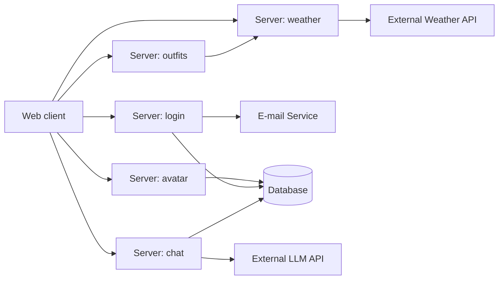

# Weatherly — weather forecasts, avatar styling

## Components

| Component | What it does | REQ |
|---|---|---|
| Server: login | Sends a 4-digit code to the user's e-mail and checks the code to log them in with a token. | REQ-001 |
| Server: weather | Gets current and next day weather data, city search results, and severe weather warnings. | REQ-002, REQ-007, REQ-008 |
| Server: outfits | Chooses clothes and accessories based on the weather forecast. | REQ-003, REQ-008 |
| Server: avatar | Saves and loads avatar selections like hair, makeup, clothes, gender, and body size. | REQ-004, REQ-005 |
| Server: chat | Handles weather and outfit questions for logged-in users with a daily message limit and calls the LLM API. | REQ-010 |
| Web client | Displays the app screens in the browser and keeps everything usable on 390 px phone screens. | REQ-006, REQ-009 |

## Architecture

